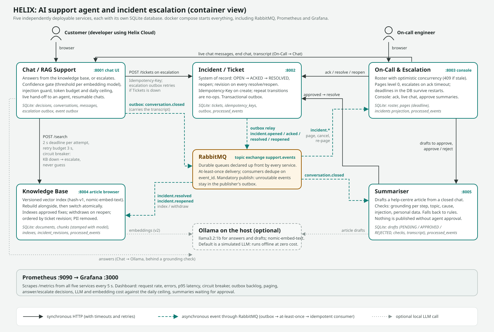
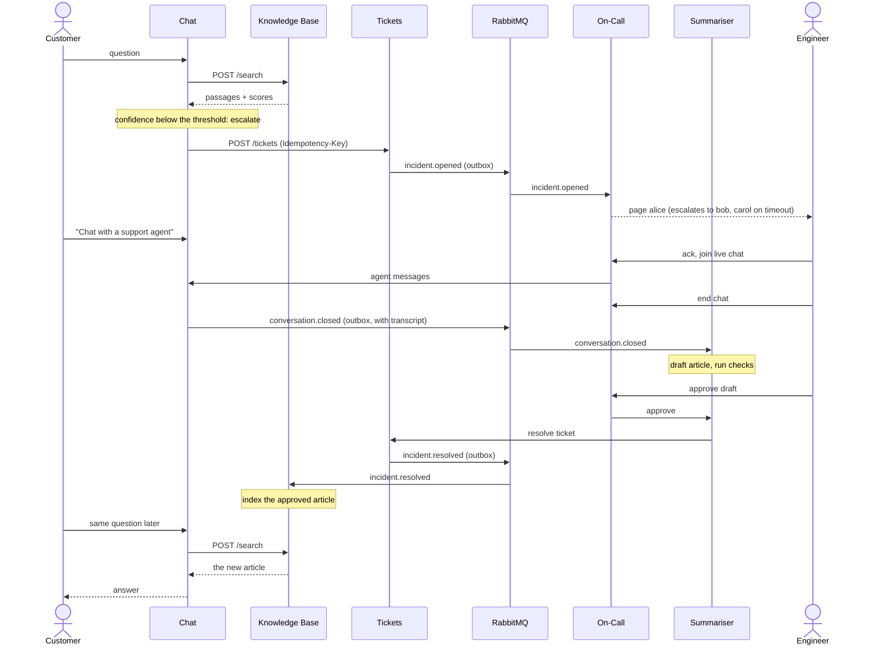
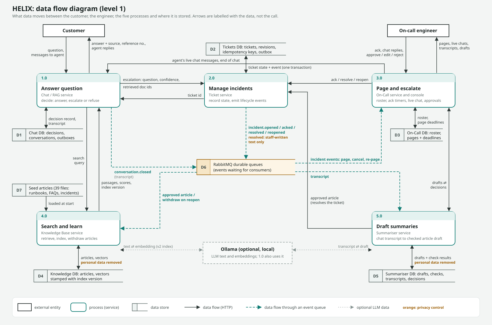

# Architecture

`architecture.svg` (scalable, for GitHub and slides) and `architecture.png` (3000 × 2020 px,
for the report) show the same C4 **container** view.

## The five services

| Service | Port | Owns | Talks to |
|---|---|---|---|
| Chat / RAG Support | 8001 | decisions, conversations, messages, escalation outbox | Knowledge (sync search), Tickets (sync create), RabbitMQ (`conversation.closed`) |
| Incident / Ticket | 8002 | tickets, idempotency keys, outbox | RabbitMQ (`incident.*`) |
| On-Call & Escalation | 8003 | roster, pages with deadlines | Tickets (ack, resolve, reopen), Chat (live chat), Summariser (approvals); consumes `incident.*` |
| Knowledge Base | 8004 | documents, versioned chunks | consumes `incident.resolved` / `incident.reopened` |
| Summariser | 8005 | drafts awaiting approval | consumes `conversation.closed`; Tickets (resolve on approval) |

Each service has its own SQLite database and Dockerfile, so each can be built and redeployed
alone. Exact APIs and event payloads: [CONTRACTS.md](CONTRACTS.md).

## Two kinds of communication

- **Synchronous HTTP** where the caller needs an answer now: searching the knowledge base
  before replying, creating a ticket, an agent acking a page. Every call has a timeout and
  retries; Chat → Knowledge also has a circuit breaker, and when it trips the customer is
  escalated, never given a guessed answer.
- **Asynchronous events** through RabbitMQ where the work can happen later and must not be
  lost: paging on-call, re-indexing a resolved incident, drafting a summary. Producers write
  the event to an **outbox** in the same database transaction as the change; a relay
  publishes it; consumers ignore duplicates by `event_id`.

## The main flow: a question the bot cannot answer

If the fix turns out to be wrong, reopening the ticket emits `incident.reopened` and the
Knowledge Base withdraws the article.

## Data flow (level 1)

`dataflow.svg` / `dataflow.png` (3200 × 2120 px) show **what data** moves between the
customer, the engineer, the five processes (1.0–5.0) and the data stores (D1–D7). Arrows are
labelled with the data itself; dashed teal flows pass through RabbitMQ (D6); orange notes
mark privacy controls.

### Where customer data ends up

| Store | Holds customer-written text? | Control |
|---|---|---|
| D1 Chat DB | yes: questions and live-chat messages (needed to show the conversation and draft a summary) | stays inside Chat; only reachable with the conversation's 128-bit ID |
| D2 Tickets DB | yes: the escalated question | the `incident.resolved` event carries only staff-written summary and fix |
| D5 Summariser DB | the transcript, for the reviewer | drafts have phone numbers, emails and card numbers removed |
| D4 Knowledge DB | **no**: only agent-approved articles | personal data removed again on ingestion; nothing is indexed without approval |
| D6 RabbitMQ | in transit only (`conversation.closed` carries the transcript) | durable queue, consumed once by the Summariser |

The knowledge base is the only store every future customer reads from, so it is the one that
never receives unreviewed customer text (proposal feedback point 5).

## Where it degrades, and how it recovers

| Failure | Behaviour | Recovery |
|---|---|---|
| Knowledge Base down or slow | escalate with `degraded`; breaker opens after 3 failures | half-open probe after 15 s |
| Tickets down during escalation | customer gets a reference; escalation kept in Chat's outbox | worker delivers it, same Idempotency-Key |
| RabbitMQ down | tickets still accepted; events wait in the outbox | relay drains the outbox |
| On-Call restarts mid-timer | page deadlines are in its database | escalation continues |
| Ollama unavailable | extractive (simulated) answers and rule-based drafts | automatic |

Measured results for each: [EVIDENCE.md](EVIDENCE.md). How to trigger them: [RUNBOOK.md](RUNBOOK.md).
